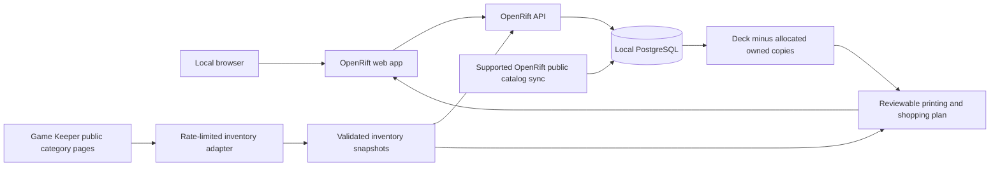

# Local Riftbound collection and shopping app

## Goal

Run a personal local copy of OpenRift to track owned cards and decks, then use Game Keeper Verdun inventory to build a reviewable list of the copies still needed. The current target is the supplied Evelynn deck. Any valid printing is acceptable; default to the cheapest available choice while making foil, alternative-art, language, condition and stock differences visible.

OpenRift will be the main app and the source of truth for collection/deck data. The existing Python store importer becomes an adapter; we will not build a second independent collection database or recreate OpenRift's deck builder.

## Current evidence

The project now lives in `Fr3nchyz/rifter`; OpenRift is pinned at `upstream/openrift` as a submodule. Private/generated inputs and outputs stay in ignored `.local/`.

- OpenRift checked out at `/workspace/rifter/upstream/openrift`, commit `eb4a7b9eb17f60fb4cc60f8d6b861b80f7b33661`. Its setup, architecture, export and authentication documentation were inspected. No dependencies or database have been installed yet.
- Stack: TanStack Start/React frontend, Hono API on Bun, PostgreSQL/Kysely. The checkout pins Bun **1.4.3**; its Compose file uses PostgreSQL **18.6**. It supports copying the public card catalog with `bun db:sync --yes`, without copying anyone else's accounts or collections.
- OpenRift already supports collection locations, per-printing ownership, decks, missing-card views, CSV import/export, conditions, languages and variants. Preserve these rather than replacing them with a smaller custom tracker.
- Existing Game Keeper importer traversed all 66 category pages and 1,563 records. It caches responses, limits request rates, uses bounded backoff, deduplicates responsive views, preserves unknown/error states, and never uses a cart. Store permission was confirmed by the user.
- Existing planner has 30 passing tests and Playwright/Chromium checks with real input. These validate the existing tool, not an OpenRift installation or integration.
- New target: 38 names / 66 copies. Sections are Legend 1, Champion 1, Battlefields 3, Main Deck 39, Rune Pool 12, Sideboard 10. Preserve the list exactly; the separately listed champion accounts for the 40th deck card when counted with the main section. No owned collection has been supplied.
- A fresh 66-page / 1,563-record retrieval completed for this target. It yields 33 candidate copies / 66 requested, 33 unfilled and CAD 166.67 subtotal before tax/shipping; one potential naming difference remains unresolved. Generated reports stay local and ignored, and availability is not a reservation.

## Architecture

Personal accounts, owned copies, decks and notes stay in the local database. Catalog updates and explicit store refreshes require Internet access. Missing card images may need the public catalog source until an appropriate local image cache is prepared; do not describe the first version as fully offline.

## Milestones

### 1. Run upstream OpenRift locally

Prepare the upstream web/API/database workflow before adding store integration.

- Use existing checkouts; cloud tasks are already isolated. Do not create a worktree unless requested.
- Install the pinned Bun version and dependencies with the frozen lockfile. Keep upstream manifests and lockfiles unchanged during setup.
- Create ignored local configuration, generate the local auth signing secret privately, start PostgreSQL, and run migrations. Keep the database persistent across restarts.
- Use the supported public catalog sync. Check configured network access and allow only the required additional catalog/image hosts. Do not request personal production tokens for public catalog sync.
- Use the documented plain-HTTP local development mode initially. Start the scanner only if its separate model prerequisites are intentionally supplied.
- Make local account signup/verification usable through a local SMTP capture service or another repository-supported development path. Do not require the user's real email credentials merely to use a local tracker.
- Leave Discord, public sharing, marketplace crawlers, production analytics and optional scheduled work out of the initial workflow using supported configuration where available.

**Acceptance:** real browser signup/login works; catalog contains real cards; add a card to a collection, restart app/database, and verify the owned quantity remains. Verify a database-backed health request, not just an open port.

### 2. Track the collection and import the Evelynn deck

- Create the user's local collection and import the supplied deck, retaining Legend, Champion, Battlefields, Main Deck, Rune Pool and Sideboard sections.
- Use OpenRift's canonical card and printing IDs. Resolve aliases or spelling differences against its catalog with review rather than silently changing the requested card.
- Add/edit/remove owned quantities using existing OpenRift collection UI. Preserve finish, language, condition and collection-location metadata.
- Support OpenRift's actual CSV export headers (`Card ID`, `Card Name`, `Quantity`, `Finish`, `Language`, etc.) in the shopping adapter. Continue accepting Rifty `code,name,count` and pasted lists.
- Confirm import behavior before updating an existing collection: a preview must state whether quantities will be added or replaced. Imports must not silently double ownership when repeated.
- Include the sideboard in shopping calculations by default for the supplied list, with a visible option to exclude it.

**Acceptance:** import/export roundtrip preserves quantities and variants; changing owned quantities updates deck shortfalls; same-card copies across metadata rows are summed correctly without double counting. The supplied deck has 66 requested copies when all sections are included.

### 3. Map store listings to the canonical catalog

This closes the biggest accuracy gap in the existing prototype.

- Map store product/variant identities to OpenRift card and printing IDs using full names, collector numbers, set identity and explicit variant fields where available.
- Fetch representative product details when needed for set/finish/condition evidence. Category markup alone does not always establish set prefixes.
- Keep product IDs, catalog IDs and purchasable variant IDs distinct. An unavailable listing with no exposed variant ID must not acquire an invented store variant ID.
- Review ambiguous mappings and save confirmed aliases locally. For example, the pasted `Invert Timelines` and the store's `Invert Timeline` are a possible naming difference, not an automatic match.
- Preserve source links, check times and mapping confidence. Unmatched cards stay visible.
- Keep CAD store prices separate from OpenRift's other marketplace price feeds; do not silently substitute currencies or prices.

**Acceptance:** fixtures cover standard, foil, alternate-art, rune, promo and double-faced/token formats. No substring/fuzzy result or other-game product can become a confirmed purchase option automatically.

### 4. Add a Game Keeper shopping view inside OpenRift

- Show the selected deck, owned quantity, quantity still needed and eligible store printings.
- Offer printing constraints: any valid printing (the user's default), specific finish/language, or a specific printing when desired.
- Default to the cheapest available matching option and split quantities across printings when required. Show each allocated lot and never allocate a variant's finite stock twice.
- Surface premium/showcase rune costs rather than making a cheap-card list look inexpensive overall.
- Distinguish: no matching listing, ambiguous mapping, explicit zero stock, insufficient stock, unknown numerical stock, stale snapshot and failed refresh.
- Show subtotals for available copies separately from unfilled quantities. Exclude tax/shipping unless independently available.
- Export all rows, including unresolved cards, as CSV with direct product links and observation times.
- Add a visible refresh action with page progress, cancellation and failure state. Reuse fresh cache; keep the last good snapshot when a refresh fails. No background polling by default.

**Acceptance:** one user flow opens the Evelynn deck, subtracts owned copies, selects store printings and exports a coherent shopping list. Forced 403/429/network/parser errors do not become zero stock or replace a good snapshot. No cart or order requests occur.

### 5. Handle multiple decks and collection allocations

- Shared cards: require the maximum per-deck count, subtracting owned copies once.
- Simultaneously built decks: sum requirements and allocate owned/store copies once across the selected decks.
- Preserve OpenRift's collection-location model so a card allocated to a deck box is not also counted as an independent binder copy.
- Apply the same explicit rule to sideboards and rune pools; show what is included in the calculation.

**Acceptance:** shared/separate examples with overlapping cards, multiple collections and finite store stock produce the expected missing counts without double allocation.

### 6. Package, back up and document

- Provide one documented local startup command, preferably a development Compose wrapper using pinned images/versions and persistent volumes. Keep local overrides outside upstream tracked configuration where supported.
- Supply setup/update, shutdown, backup/restore and CSV export instructions. A database restore must preserve account access, ownership and deck associations.
- Save tested cloud install/start instructions and the complete repository membership only after setup/discovery is verified. Publishing the environment is a separate user action; running services will need restart after restoration.
- Preserve OpenRift's AGPL license and attribution for any reused or modified code; keep the store adapter clearly separated for maintenance.

**Acceptance:** a fresh checkout can be started from the instructions; a test collection survives restart and backup/restore; no credentials appear in tracked files, logs or exports.

## First usable release

Milestones 1–4 are the initial release: local OpenRift, durable collection tracking, the Evelynn deck and a Game Keeper shopping view. Multiple-deck allocation and polished packaging follow once that vertical slice works. A card scanner, mobile installer, public hosting, trading groups and additional stores are optional later work.

## Decisions already made

- Main application: OpenRift, running locally.
- Collection source of truth: local PostgreSQL behind OpenRift.
- Store: Game Keeper Verdun; permission confirmed in the chat.
- Default buying preference: any valid printing, cheapest available; expensive variants remain visible and selectable.
- Inventory access: ordinary public read-only requests with conservative rate/cache/backoff; no protection bypass, cart changes or orders.
- Deck target: the latest Evelynn list, replacing the earlier 156-copy Rifty target. Owned quantities remain unknown until entered/imported.

## Outstanding verification

- OpenRift dependency installation, database migrations, catalog seeding and local signup have not been run yet.
- Its actual local import/export/API behavior must be exercised before integrating collection data.
- Reliable canonical mapping for every requested card has not been established. Review spelling/printing conflicts explicitly.
- Availability can change during and after a multi-page refresh. A shopping plan is a dated snapshot, never a reservation or purchase guarantee.
